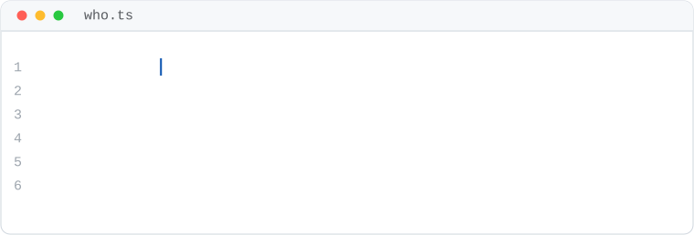

<picture>
  <source media="(prefers-color-scheme: dark)" srcset="assets/who-dark.svg">
  
</picture>

---

## 만든 것

모두 퇴근 후에 Claude와 함께 만든 것들입니다. 요즘은 Claude Code를 쓰는데, 코드는 대부분 AI가 짜고 저는 무엇을 만들지 정하고 결과를 확인합니다.

### 🏷 QR태그 · [qtag.kr](https://qtag.kr) 비공개

제품에 붙이는 QR 스티커 서비스입니다. 소비자는 제품명을 검색하지 않고도 QR 하나로 판매 페이지에 들어갑니다. 등록되지 않았거나 막힌 코드는 경고 페이지로 보냅니다. 기획부터 운영까지 혼자 맡고 있습니다.

`Next.js` `TypeScript` `Supabase` `Vercel`

### 📞 통화 비서 비공개

통화를 업무 기록으로 남기고, 제가 어떻게 말했는지도 돌아보려고 만들었습니다. 녹음을 받아써서 요약하고, 할 일과 말하기 코칭까지 정리해 줍니다. 노트북에 켜 두면 새 녹음을 알아서 처리하고 아침마다 브리핑을 보냅니다. 주민번호와 카드번호는 AI에 넘기기 전에 가립니다.

`Python` `Claude Code` `faster-whisper` `SQLite` `Notion` `Slack`

### 🎬 콘텐츠 제작 파이프라인 비공개

쇼츠 한 편에도 조사, 대본, 그림, 음성, 편집이 모두 들어갑니다. 이 일을 AI 에이전트들에게 나눠 맡기면 사람 손을 어디까지 줄일 수 있는지 궁금해서 시작했습니다. 지금은 쇼츠와 카드뉴스, 블로그 글을 매주 정해진 시간에 알아서 만들고, 멈추면 휴대폰으로 알림이 옵니다.

`Python` `Claude Code` `Remotion` `ffmpeg` `YouTube Data API`

### 🍽 QR 테이블오더 비공개

식당용 주문 웹앱입니다. 손님이 테이블에 붙은 종이 QR 한 장으로 메뉴를 고르고 계산까지 마치니, 식당은 태블릿 주문기가 필요 없습니다. 같은 테이블에 앉은 사람들은 각자 휴대폰으로 장바구니 하나를 함께 채웁니다. 결제는 아직 모의 결제까지만 확인했습니다.

`Next.js` `TypeScript` `Supabase` `PortOne`

### 🎙 voice-record

녹음 파일을 글로 바꿔 주는 무료 도구입니다. 웹판은 휴대폰 브라우저 안에서 변환하므로, 회의 녹음처럼 남이 들으면 안 되는 음성도 기기 밖으로 내보내지 않고 받아쓸 수 있습니다. 처음에는 AI가 짧은 문장 하나로 시험해 보고 엔진을 바꿨는데, 실제 회의 녹음으로 다시 돌려 보니 단어가 엉뚱하게 붙어 원래 엔진으로 되돌렸습니다.

`Python` `faster-whisper` `transformers.js` → **[저장소](https://github.com/JeongSangMyeong/voice-record)**

### 🖐 손 재활기기 게임

2024년에 개인 외주로 만든 태블릿 게임입니다. 손에 쥐는 재활기기를 기울이거나 눌러서 벽돌깨기, 비행기 슈팅, 테트리스를 하며 손 재활 훈련을 합니다. Flutter와 Dart를 모르던 때라 Claude에게 하나씩 물어 가며 개발했는데, 생각보다 금방 완성돼서 신기하고 재미있었습니다. ▶︎ **[시연 영상](https://youtu.be/gWzqYVhK05c)**

`Flutter` `Dart` `블루투스 시리얼(SPP)` → **[저장소](https://github.com/JeongSangMyeong/hand-rehab-game)**

---

## 공부하며 만든 것

- **[Spring-boot-Photogram](https://github.com/JeongSangMyeong/Spring-boot-Photogram)** · Spring Boot 3로 만든 인스타그램 클론입니다. 강의 코드의 버그를 고치고 기능을 더한 부분은 [README](https://github.com/JeongSangMyeong/Spring-boot-Photogram#직접-구현한-부분)에 커밋까지 적어 두었습니다.
- **[naver-search](https://github.com/JeongSangMyeong/naver-search)** · 네이버 검색 API 6종(블로그·뉴스·책·카페·지식인·지역)을 한 화면에서 검색할 수 있습니다. Next.js 14로 만들었습니다.
